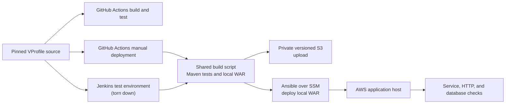

# cicd-pipeline-vprofile

Project 3 of a DevOps learning portfolio. This repository practices building,
testing, and deploying the instructor-provided VProfile application. The
application itself was not authored for this project.

## What the project demonstrates

- Automated build and test checks with GitHub Actions.
- A separate, manually dispatched GitHub Actions deployment workflow and a Jenkins
  deployment pipeline, with recorded deployments on both platforms.
- Terraform-managed AWS infrastructure and Ansible-based application deployment.
- Deployment health checks and a deliberately exercised same-app recovery path.

## Architecture and delivery flow

GitHub Actions runs build/test checks on pull requests and pushes to `main`;
public pull-request workflows do not receive AWS deployment credentials.
Deployment is a separate manual workflow that authenticates to AWS through OIDC.
The Jenkins pipeline was used in recorded tests; it assumes a deploy role from its
agent identity. The Jenkins test environment was reported torn down and is not
running. These are separate deployment paths with different credentials and
execution environments; full platform parity has not been established.

Both deployment pipelines build the WAR locally with the shared script, upload it
to private versioned S3 using their non-root deploy roles, and pass the local build
to Ansible over Systems Manager. Neither pipeline downloads the WAR from S3 for
deployment. Named-version retrieval from S3 using a non-root identity was not
demonstrated; the artifact acceptance scope was narrowed on 2026-11-09.

## Technology stack

- **Application and runtime:** The instructor-provided Java application is built
  and tested with Maven, then packaged as a WAR. Tomcat serves the application;
  MariaDB stores its data, Memcached provides caching, and RabbitMQ provides
  messaging.
- **CI/CD:** GitHub Actions for build/test and manual deployment; Jenkins for a
  separate deployment path used in recorded tests.
- **Infrastructure:** Terraform provisions and manages AWS resources.
- **Configuration management:** Ansible for host configuration, deployment, and
  health checks.
- **Deployment access and artifacts:** AWS Systems Manager provides private host
  access for Ansible; private versioned Amazon S3 stores pipeline WAR uploads.

## Results, limitations, and evidence

Project records report successful deployments through both platforms and intentional
failure tests that restored the same application build and checked its health. This
does not demonstrate rollback to a distinct previous release. Evidence is dated and
is not a live check of current infrastructure, Jenkins, GitHub Actions, or billing.

JaCoCo was used for a one-off local measurement of the instructor-provided
application tests; it is not CI coverage. The bootstrap- and durable-bucket
`terraform:S6258` findings are recorded as Accepted, not fixed
([CI parity and quality review](docs/ci-parity-and-quality-review.md)).

The 2026-11-07 S3 Versions view reportedly showed 15 WAR versions, and a root-console
download was reported. The download was not tied to a specific object version and
does not demonstrate least-privilege retrieval. Named-version retrieval by a
non-root identity remains unproven under the revised 2026-11-09 acceptance scope.

Permission to use and redistribute the instructor-provided application is
unresolved; this repository does not publish a WAR or copy of its application
source. Keep credentials, Terraform state, and private artifacts out of public files
and logs. The project is not presented as a tested public setup or deployment guide.

## Repository guide

- `.github/workflows/build-test.yml` — GitHub Actions build/test workflow.
- `.github/workflows/deploy.yml` — manually dispatched GitHub Actions deployment.
- `Jenkinsfile` — Jenkins build and deployment pipeline.
- `scripts/build.sh` — shared local build, test-count, and WAR checks.
- `ansible/deploy.yml` — deployment and application health-check playbook.
- `infra/` — Terraform configuration, separated into bootstrap, durable, and
  ephemeral resources.
- [PROGRESS.md](PROGRESS.md) — current project handoff and Definition of Done.
- [PROGRESS-HISTORY.md](PROGRESS-HISTORY.md) — dated evidence and milestones.
- [NOTES.md](NOTES.md) — technical explanations and lessons.
- [CI parity and quality review](docs/ci-parity-and-quality-review.md) — workflow
  comparison, run evidence, and quality-check limits.
- [Decision records](docs/decisions/) — infrastructure and implementation decisions.
